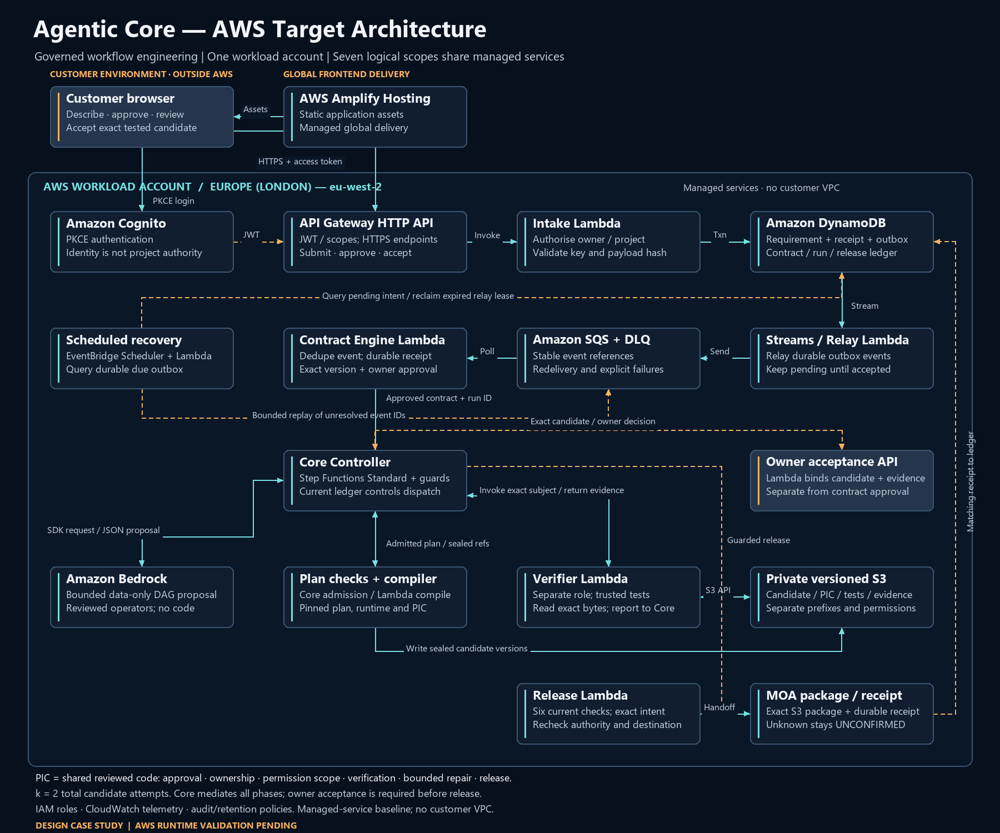

# Agentic Core

Agentic Core is Jyothesh Karnam's personal project for compiling bounded requirements into governed workflows. This public repository contains the actual deterministic Python and SQLite core excerpt, with synthetic tests and an independently labelled reference design.

## What this source implements

- Typed requirements, workflow packages and output schemas; graph and version/hash validation.
- Deterministic capability selection with availability, trust, compatibility, dependency, conflict and budget constraints.
- Engine-scoped permission rules, approval hashes, denial precedence, path checks and redaction.
- Local SQLite runs, tasks, approvals and events; sequential task advancement, checkpoints, bounded retries, cancellation and ambiguous-outcome reconciliation.
- Pending host requests and locally attested receipts. The desktop host supplies model reasoning and supported tool execution.

The excerpt consists of **five core Python modules and two synthetic test modules**. It contains no mail-provider or model API adapter, hosted server, independently running background agents or operational job-search records. Local receipts are not provider signatures, and remote exactly-once execution is not established.

## Run the synthetic tests

Use Python 3.11 or later:

```bash
python -m venv .venv
# Activate the environment using your shell's normal command.
python -m pip install -r runtime/requirements.txt
cd runtime
python -B -m unittest discover -s tests -p "test_core*.py" -v
```

The tests construct synthetic cases and temporary SQLite state. They do not call models, send messages or access live career data. The exported-source verification result is recorded in [docs/verification/core-tests.json](docs/verification/core-tests.json). Its result applies only to these files, not to a separate full native-plugin release or an AWS deployment.

On a restricted Windows host, Python's default temporary directory may be inaccessible. Use a writable temporary directory for the test process and record that environment adjustment; do not change source assertions to obtain a passing run.

## Architecture and design scope

Start with the **[current scoped AWS case study](docs/diagrams/Agentic-Core-AWS-Case-Study.md)** and its [diagram index](docs/diagrams/README.md), recovered from System Architecture Workspace v81, source dated **24 October 2026**.



This target design separates approval of the exact contract from the owner's later acceptance of the exact verified candidate. It allows **two total candidate attempts: the initial attempt and at most one admitted repair**. Bounded plan proposals, reviewed operators, independent verification, guarded release and separately authorised child operation are design requirements. AWS deployment and cloud runtime validation remain pending.

The implemented **26 September Python excerpt** is a local, sequential workflow engine. Read [contracts.py](runtime/core/contracts.py), [safety.py](runtime/core/safety.py) and [engine.py](runtime/core/engine.py) to inspect its actual boundaries. Its 35 passing synthetic tests do not establish implementation of the whole October AWS target.

The [10 October foundation reference](docs/architecture/agentic-core-foundation-v0.1.json) is an earlier **proposed design with conditional derivations and defined acceptance tests**. It describes four internal components, inherited PIC controls and proposed AWS mappings. Those design tests are not measured passing results.

The supplementary enterprise diagrams use different scale and isolation assumptions. They are reference studies, not the scoped case study's deployment diagram. See the [architecture evidence index](docs/architecture/README.md) for the three evidence classes and [diagram provenance](docs/diagrams/diagram-manifest.json) for original paths and file hashes.

## Provenance and attribution

The runtime source is copied from the exact reviewed source revision recorded in [SOURCE_PROVENANCE.json](SOURCE_PROVENANCE.json). It preserves the original logical content and relative layout. The reference JSON has its own source revision and blob identity.

Project author credited by the source: **Jyothesh Karnam**, with Codex host and model assistance. This is an independent personal project, not Amazon source code or an Amazon-endorsed product. Python and SQLite are runtime dependencies; schema validation uses `jsonschema`. See [NOTICE.md](NOTICE.md).

## Limitations

The host remains responsible for reasoning and supported tools. Guardian checks operate inside this engine; they do not replace host/tool permissions. SQLite state is local. Synthetic coverage does not establish production reliability, unattended operation, a complete plugin installation or a live connection to QUASAR, ATLAS, NEBULA or PULSAR.
